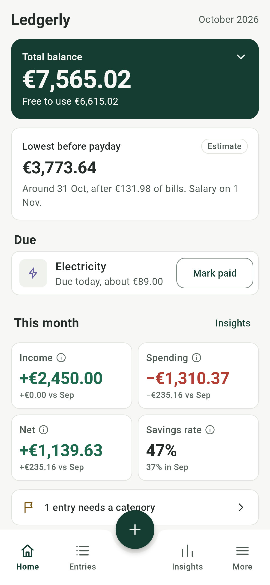
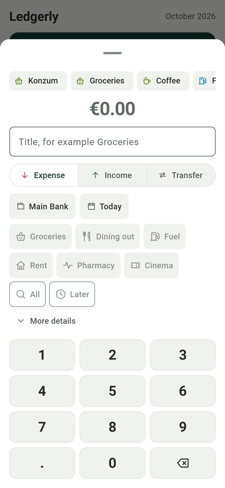
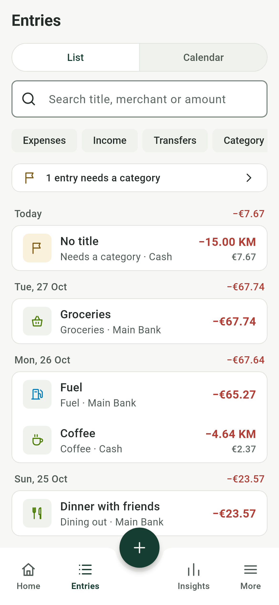
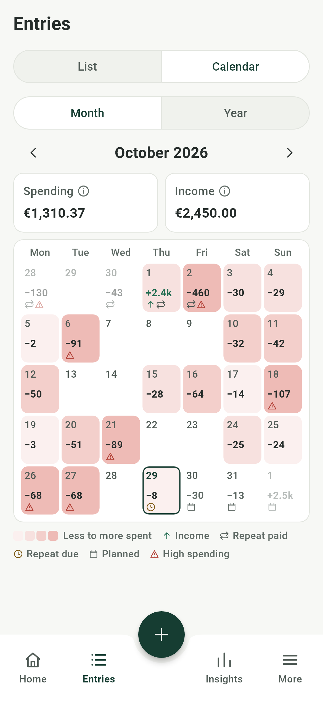
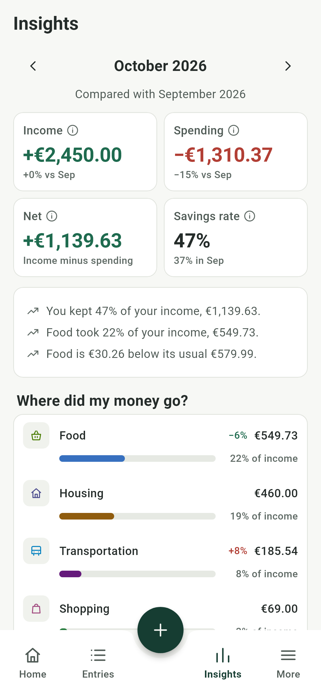
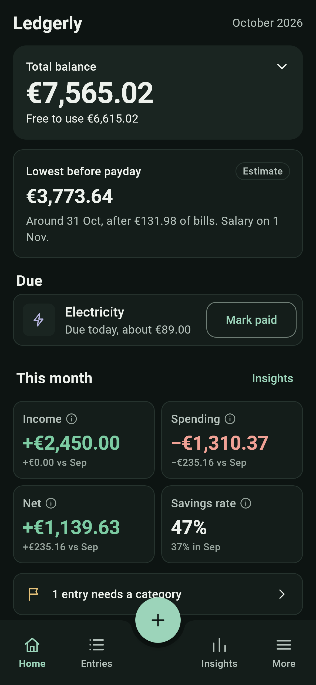
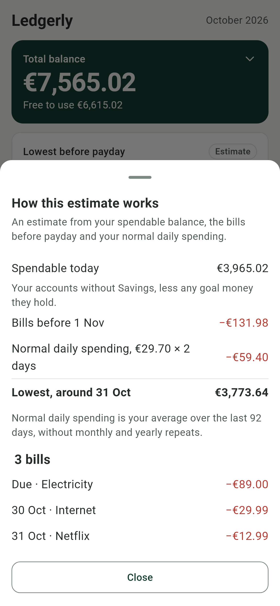
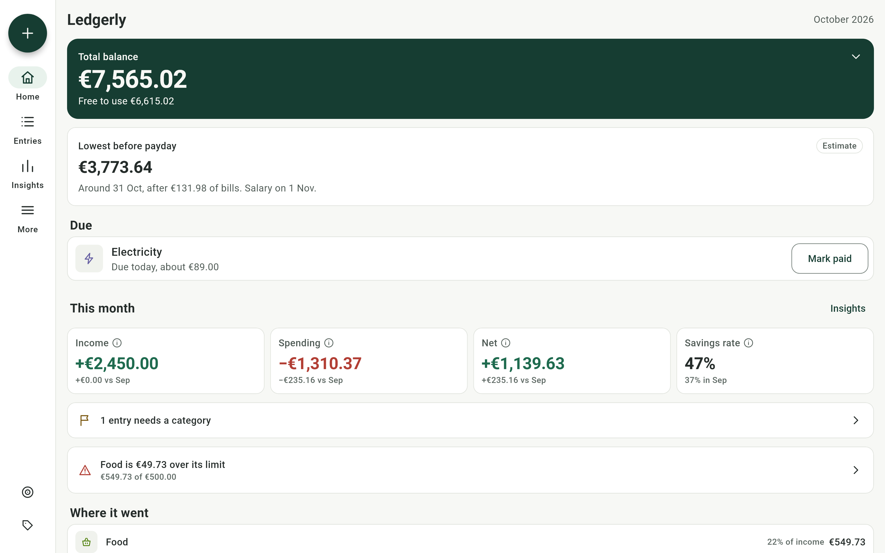

# Ledgerly

**A personal finance manager that never needs the internet.** Ledgerly records an expense in two taps plus the digits,
shows where your money goes and how much will be left before payday, and keeps every number in a database on your own
device. There are no accounts, no cloud and no tracking. Release builds can't even reach the network.

By **Danilo Vrancic**.

<p>
  
  
  
</p>
<p>
  
  
  
</p>
<p>
  
</p>


The screenshots show fictional demo data.

## What it does

- **Two taps per expense.** Tap Add, type the amount, tap a category chip, and it's saved, with Undo. The titles you use
  most sit at the top of the sheet, and typing a title you used before brings back its category and account.
- **Will I make it to payday?** Home estimates the lowest you will have before the next salary. It starts from your
  spendable balance, then takes off the bills due before payday and your normal daily spending. One tap shows exactly
  how it is worked out.
- **Where the money went.** Insights compares any month with the one before and with your usual level: income,
  spending, net, savings rate, every category with its share of income, and a six-month chart. Every figure opens the
  entries behind it.
- **A financial calendar.** Each day shows its net and a shade for how much was spent, with markers for income, paid
  and due repeats and high-spending days. A year view shades all twelve months.
- **Repeats, not surprises.** Rent, salary and subscriptions turn Due on their date and wait until you mark them paid
  or skip them. Nothing is ever posted twice.
- **Budgets and savings goals.**
  - **Budgets** are monthly or weekly limits for all spending or one category. Each shows how much is safe to spend per
    day, warns at 80% and shows when it goes over.
  - **Savings goals** keep money in your account but mark it as not free to spend, and show what to set aside each
    month.
- **Money handled properly.**
  - Amounts are stored as whole cents in their own currency (EUR and BAM), with the euro value frozen when recorded.
  - Transfers never count as income or spending, and refunds lower spending instead of counting as income.
  - Balances are always calculated, never stored.
- **Your data stays yours.**
  - **Backups** are made automatically every 3 days, to a folder you choose if you like.
  - **Export** writes everything to one `.ledgerly` file, optionally protected with a password in the open
    [age](https://age-encryption.org) format.
  - **Bank statement import** reads a CSV export from your bank and finds what is already recorded.
- **App lock.** A PIN on every platform, the fingerprint or face unlock on Android, and the app hidden in recent apps
  while it's locked.
- **Screens:**

  | Screen | What's on it |
  | --- | --- |
  | Home | Balance, lowest before payday, due repeats, this month, where it went, recent entries |
  | Add | Frequent titles, keypad, category chips, more details |
  | Entries | Search (diacritics optional, amounts too), filters, list or calendar |
  | Insights | Month comparison, categories, income sources, six-month chart |
  | Budgets | Limits with pace, safe per day and the last six periods |
  | Savings | Goals with a target, a date and progress |
  | Repeats | Due, coming up, and the cost of subscriptions |
  | Accounts | Balances and balance checks |
  | Settings | Theme, month start, categories, backups, export and import, app lock |

- **Light and dark themes**, and a layout that grows from a 360 px phone to a desktop window with a navigation rail.

## Repository layout

| Path | What's there |
| --- | --- |
| `app/` | The Flutter app (package `ledgerly`). Its [README](app/README.md) has the full feature list and the money rules |
| `design-system/` | Tokens, colours, type, the line icon set and the brand icon the app uses |
| `prototype/` | The clickable HTML prototype the app follows |
| `docs/` | The design brief, architecture and usability reviews, and `screenshots/` for this README |
| `.devflow/plans/` | The implementation plans each feature was built from |

Inside `app/lib/`:

```
domain/    plain Dart: postings, repeats, budgets, savings plans, insights, the payday forecast
data/      Drift database, repositories (the only code that touches the database), backups, export
features/  one folder per area of the app
ui/        the design system in Flutter: colours, type, icons, shared widgets
core/      money, days, months, ids and text search
app/       app root, shell, navigation and Riverpod providers
```

## Set it up from the code

### 1. Install the tools

- **Flutter 3.47.9** (stable; it ships Dart 3.13). Follow the guide at <https://docs.flutter.dev/get-started/install>.
  - Install Flutter in a folder **without spaces**, for example `C:\flutter` or `~/flutter`. Flutter's native build
    hooks break on paths like `C:\Program Files\...`.
  - Run `flutter doctor` and fix what it reports for the platforms you want.
- Then add the tools for each target platform:

  | Target | You also need |
  | --- | --- |
  | Android | Android Studio with an Android SDK, and an emulator or a phone with USB debugging (Android 8.0 or newer) |
  | Windows | Visual Studio 2022 with the *Desktop development with C++* workload |

### 2. Get the code and its packages

```bash
git clone https://github.com/DaniloVrancic/ledgerly.git
cd ledgerly/app
flutter pub get
```

The generated database code is committed, so the app builds straight away. Regenerate it after changing the tables:

```bash
dart run build_runner build      # after editing lib/data/database/tables.dart
```

### 3. Run it

```bash
flutter run -d windows           # Windows desktop
flutter run                      # the connected Android phone or emulator
```

### 4. Run the checks

```bash
dart analyze
flutter test                                  # unit, repository and widget tests
flutter test test_screens --update-goldens    # renders the README screenshots to docs/screenshots/
```

## Build an app you can use

All builds run from `app/`. Each one keeps its data on the device it runs on.

### Android phone (APK)

```bash
flutter build apk --release --split-per-abi
```

The APKs land in `build/app/outputs/flutter-apk/`. Most phones need `app-arm64-v8a-release.apk`. To install it:

- **Over USB:** connect the phone with USB debugging on and run `flutter install`.
- **By hand:** copy the APK to the phone and open it. Android will ask you to allow installs from that source.

The release manifest removes the INTERNET permission, so the installed app cannot go online.

### Windows desktop

```bash
flutter build windows --release
```

The app is in `build/windows/x64/runner/Release/`. Copy the **whole folder**, not only `ledgerly.exe`, wherever you
want and start `ledgerly.exe`.

## Where your data lives

| | Database | Backups |
| --- | --- | --- |
| Android | The app's private folder | `Android/data/app.ledgerly.ledgerly/files/backups`, or a folder you choose |
| Windows | `%APPDATA%\app.ledgerly\ledgerly\ledgerly.sqlite` | `Documents\Ledgerly\Backups`, or a folder you choose |

Uninstalling the app on Android removes its own backup folder, so choose a folder of your own under
**Settings → Backups**, or export a `.ledgerly` file now and then.

## How it works (short version)

- **Storage.** [Drift](https://drift.simonbinder.eu/) on SQLite. The schema is versioned, and every upgrade has a
  migration test. Every record has a UUID, `updatedAt` and a soft `deletedAt`, so sync could be added later without
  moving anything.
- **Money rules.** Each entry becomes postings, and income and spending only ever come from postings with a category,
  so a transfer can't count by construction. The rules live in `lib/domain/` as plain Dart and are covered by tests.
- **State.** [Riverpod](https://riverpod.dev/) providers read live database queries, so every screen updates the moment
  something changes.
- **Offline by design.** No fonts, icons or anything else are fetched at runtime. The icons are the design system's own
  line set, drawn from SVG paths.

The full feature list, the money rules and the code organisation are in [`app/README.md`](app/README.md). The design
brief is in [`docs/design-prompt.md`](docs/design-prompt.md).

## Credits

- Design, code and brand: Danilo Vrancic.
- Built with [Flutter](https://flutter.dev), [Drift](https://drift.simonbinder.eu/), [Riverpod](https://riverpod.dev/)
  and [fl_chart](https://pub.dev/packages/fl_chart).
- Export encryption follows the [age](https://age-encryption.org) format.

© 2026 Danilo Vrancic. All rights reserved.
